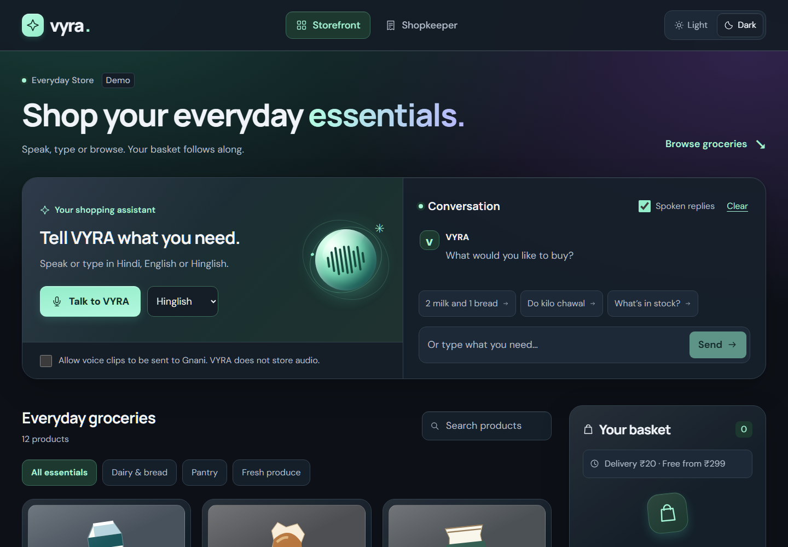
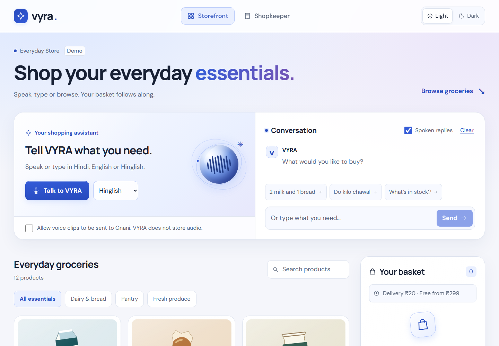
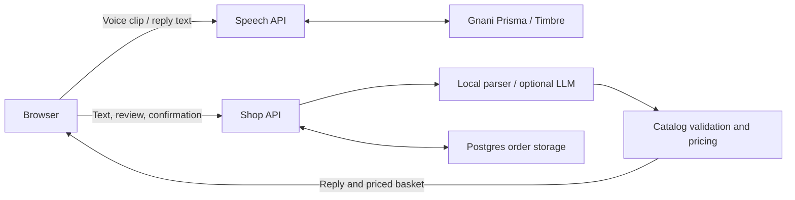

# VYRA

### Your store. A voice away.

**Multilingual grocery shopping with voice, an editable basket, and a clear order review.**

[](package.json)
[](package.json)
[](tsconfig.json)

**[Open the live demonstration video!]([https://vyra-gnani.vercel.app](https://drive.google.com/file/d/1uGv_Z2SJRUE9sYwRYcI0Mgv-rZMB5KzC/view?usp=sharing))** · [Quick start](#quick-start) · [Architecture](#architecture) · [Testing](#testing-and-verification) · [Deployment guide](docs/DEPLOYMENT.md)

VYRA is a working grocery commerce demo for people who prefer to describe what they need in **Hindi, English, or Hinglish**. A shopper can speak, type, or browse the catalog; VYRA builds a basket with validated quantities and catalog prices. After the shopper reviews and confirms the order, a shopkeeper workspace tracks it from **Received → Packing → Ready**.

The application combines **Gnani Prisma** transcription and **Gnani Timbre** speech synthesis with deterministic commerce rules. The deployed demo runs on **Vercel** and stores orders in **Neon Postgres**.

> **Demo scope:** Products, stock limits, delivery fees, and orders are for demonstration. VYRA does not collect payments or arrange real deliveries.



<details>
<summary>View the light theme</summary>



</details>

## Contents

- [Overview](#overview)
- [Try the live demo](#try-the-live-demo)
- [Features](#features)
- [Technology stack](#technology-stack)
- [Architecture](#architecture)
- [Quick start](#quick-start)
- [Environment variables](#environment-variables)
- [Project structure](#project-structure)
- [API overview](#api-overview)
- [Testing and verification](#testing-and-verification)
- [Deployment](#deployment)
- [Security and data handling](#security-and-data-handling)
- [Troubleshooting](#troubleshooting)
- [Current limitations](#current-limitations)
- [Contributing](#contributing)
- [Documentation](#documentation)
- [License](#license)

## Overview

Use VYRA to explore multilingual ordering, inspect a speech-to-action pipeline, or develop a grocery-store prototype. Its two workspaces cover the customer interaction and order-preparation workflow:

| Workspace | What you can do |
| --- | --- |
| **Storefront** | Speak or type requests, search groceries, filter categories, change quantities, and review the final basket. |
| **Shopkeeper** | View this browser session's confirmed orders, move them through fulfilment states, and download receipts. |

Text shopping works locally without external credentials. Voice requires a Gnani key. An optional language model can extend intent extraction; catalog validation, pricing, and checkout confirmation remain application-controlled.

## Try the live demo

**Visit [vyra-gnani.vercel.app](https://vyra-gnani.vercel.app).** The public deployment has live Gnani speech and persistent Postgres order storage configured.

1. Choose **Hinglish**, **English**, or **हिंदी**.
2. Type a shopping request, or enable the voice-processing consent checkbox and select **Talk to VYRA**. Allow microphone access in your browser when prompted.
3. Stop the recording when finished. The conversation displays your request and the resulting basket update.
4. Adjust any quantities, select **Review order**, and check pack sizes, delivery, and total.
5. Select **Confirm demo order**, then open **Shopkeeper** to start packing, mark the order ready, or download its receipt.

### Example requests

| Intent | Example |
| --- | --- |
| English shopping | `2 milk and 1 bread` |
| Hinglish shopping | `Do litre doodh aur ek kilo chawal` |
| Hindi shopping | `दो लीटर दूध और एक किलो चावल` |
| Change a quantity | `make it 1 milk instead` |
| Remove a product | `remove milk` |
| Check availability | `What's in stock?` |

Quantities refer to the catalog's package sizes. For example, milk is sold as a **1 litre** pack, rice as a **1 kg** pack, and eggs as a **6 pack**. Review the basket after a voice or text request.

### Example basket

For **“Do litre doodh aur ek kilo chawal”**:

| Item | Quantity | Unit price | Amount |
| --- | ---: | ---: | ---: |
| Fresh milk, 1 litre | 2 | ₹60 | ₹120 |
| Everyday basmati, 1 kg | 1 | ₹95 | ₹95 |
| **Subtotal** | | | **₹215** |
| Demo delivery | | | ₹20 |
| **Total** | | | **₹235** |

The demo delivery fee is **₹20 below a ₹299 subtotal** and **free from ₹299**. An empty basket has no delivery charge.

## Features

### Shopping and fulfilment

- Twelve catalog products with English and Hindi names, package sizes, prices, and per-order stock limits.
- Product search, category filters, quantity controls, and clear sold-out states.
- Hindi, English, and Hinglish intent handling, including supported corrections, removals, and stock questions.
- Server-calculated totals and delivery; unknown products, fractional packs, and unavailable quantities are validated.
- Editable baskets, signed order reviews, explicit confirmation, and duplicate-checkout protection.
- Session-scoped orders, fulfilment transitions, and downloadable text receipts.

### Voice interaction

- Gnani **Prisma v2.5** transcription and **Timbre v2.5** spoken replies through server-side API routes.
- Opt-in microphone recording with a **25-second cap**, track cleanup, and conversion to **16 kHz mono, 16-bit PCM WAV**.
- Visible transcripts, optional spoken replies, and controls to stop playback.
- Cancellation of pending speech when muted, recoverable provider errors, and continued access to text shopping.
- Optional Prisma v3.0 configuration; the recorded live acceptance tests use v2.5.

### Interface

- Glossy surfaces, clear page sections, original SVG product artwork, and responsive layouts.
- **Light mode:** pearl surfaces with cobalt accents. **Dark mode:** charcoal surfaces with mint accents.
- System-theme detection and a saved manual theme preference.
- 18 px body text, secondary text of at least 16 px, visible keyboard focus, and reduced-motion support.
- Desktop basket access and a mobile basket shortcut that hides when the basket itself is visible.

## Technology stack

| Layer | Technology | Role |
| --- | --- | --- |
| Application | Next.js 15 App Router, React 19, TypeScript | Pages, client interaction, and Node.js API routes |
| Interface | Custom CSS, theme variables, SVG | Responsive layout, themes, and product artwork |
| Speech recognition | Gnani Prisma | Convert recorded speech into text |
| Speech synthesis | Gnani Timbre | Generate spoken replies |
| Intent extraction | Local parser; optional OpenAI-compatible LLM | Translate requests into catalog actions |
| Commerce | TypeScript domain logic | Validate products and quantities, calculate prices, and enforce checkout rules |
| Persistence | Neon Postgres; local memory fallback | Store confirmed demo orders |
| Verification | Node test runner with `tsx`, Playwright | Unit, provider-contract, HTTP, and browser checks |
| Hosting | Vercel | Public HTTPS deployment and server-side functions |

Dependencies and scripts are defined in [package.json](package.json); reproducible dependency versions are recorded in [package-lock.json](package-lock.json).

## Architecture



### Request processing

1. **Capture or type.** The browser records a short clip or accepts a text request. Voice uploads pass through the speech route; provider credentials remain on the server.
2. **Extract intent.** The local parser identifies supported catalog actions. If an LLM is configured, its response is validated; a failed model request falls back to the local parser.
3. **Apply commerce rules.** Code checks catalog IDs, whole-pack quantities, stock ceilings, and prices. The client and language model do not supply authoritative totals.
4. **Review and confirm.** The server issues an HMAC-signed review with a ten-minute expiry, bound to the browser session. An order is saved only after explicit confirmation.
5. **Track fulfilment.** The shopkeeper workspace reads the session's orders and advances their status. The quote ID becomes the order ID, with a database uniqueness constraint preventing duplicate checkout writes.

### Key modules

| Module | Responsibility |
| --- | --- |
| [Storefront.tsx](src/components/Storefront.tsx) | Shopping UI, recording lifecycle, conversation, review, and order board |
| [catalog.ts](src/lib/catalog.ts) | Product definitions, basket validation, and pricing |
| [commerce.ts](src/lib/commerce.ts) | Local intent parsing and validated basket actions |
| [gnani.ts](src/lib/gnani.ts) | Speech requests, response validation, timeouts, and selected transient HTTP retries |
| [checkout.ts](src/lib/checkout.ts) | Session/review signing and review verification |
| [shop-store.ts](src/lib/shop-store.ts) | Postgres persistence and local memory fallback |
| [ThemeToggle.tsx](src/components/ThemeToggle.tsx) | System-theme detection and saved theme selection |

## Quick start

### Prerequisites

- **Node.js 20.9 or newer** and npm.
- A current browser. Chromium is used for the recorded browser tests.
- A Gnani API key for voice features; text shopping needs no external key locally.

Open the project directory containing `package.json`, then run the commands below. Existing `.env.local` files are preserved.

**Windows / PowerShell**

```powershell
npm ci
if (!(Test-Path .env.local)) { Copy-Item .env.example .env.local }
npm run dev
```

<details>
<summary>macOS / Linux</summary>

```bash
npm ci
[ -f .env.local ] || cp .env.example .env.local
npm run dev
```

</details>

Open **[http://127.0.0.1:3000](http://127.0.0.1:3000)**. You can immediately browse products and try text requests.

To enable voice, add `GNANI_API_KEY` to `.env.local` and restart the server. A microphone requires a secure browser context: HTTPS on the public deployment, or a supported loopback address for local development.

### Run an optimized local build

Set `SESSION_SECRET` in `.env.local`, then run:

```powershell
npm run build
npm start
```

Both development and production start scripts bind to `127.0.0.1` locally. Vercel uses the framework build and its own function runtime.

## Environment variables

Use [.env.example](.env.example) as the configuration template. Keep real values in `.env.local` for local work and in Vercel environment settings for deployment.

| Variable | Requirement | Purpose / default |
| --- | --- | --- |
| `GNANI_API_KEY` | Required for voice | Server-side access to Prisma and Timbre |
| `GNANI_STT_MODEL` | Optional | Defaults to `prisma-v2.5`; set to `prisma-v3.0` to select the optional model |
| `SESSION_SECRET` | Required in production | Signs browser-session cookies and order reviews; use a secret generated from at least 32 random bytes |
| `DATABASE_URL` | Required for reliable hosted orders | Neon-compatible Postgres URL; absent locally means temporary in-memory storage |
| `LLM_API_KEY` | Optional | Enables external intent extraction; absent means the local parser |
| `LLM_BASE_URL` | Optional | OpenAI-compatible endpoint; default `https://api.groq.com/openai/v1` |
| `LLM_MODEL` | Optional | Default `openai/gpt-oss-20b` |

Generate a session secret with:

```powershell
node -e "console.log(require('node:crypto').randomBytes(32).toString('hex'))"
```

Use a separate secret for production and keep it consistent across instances. Development generates a temporary secret when none is configured; production requests fail if it is missing. Restart local processes after changing their environment. Vercel environment changes take effect in a subsequent deployment.

Speech credentials must remain server-side. Do not place keys in `NEXT_PUBLIC_*` variables, commit `.env.local`, or include secret values in screenshots and issue reports.

## Project structure

```text
.
├── src/
│   ├── app/
│   │   ├── api/
│   │   │   ├── shop/route.ts       # Shopping, review, checkout and order actions
│   │   │   └── speech/route.ts     # Transcription and speech synthesis
│   │   ├── admin/page.tsx          # Redirect to the shopkeeper workspace
│   │   ├── globals.css             # Layout, typography and theme tokens
│   │   ├── layout.tsx              # Root layout, metadata and theme bootstrap
│   │   └── page.tsx                # Storefront entry point
│   ├── components/                 # Storefront, theme controls, icons and artwork
│   └── lib/                        # Commerce, speech, signing and persistence
├── tests/
│   ├── unit/                       # Domain rules and mocked provider contracts
│   ├── integration/                # HTTP checks and opt-in live speech checks
│   └── e2e/                        # Browser workflows and regression coverage
├── docs/
│   ├── assets/                     # Screenshots used in this README
│   └── ...                         # Demo, deployment and validation guides
├── .preview/                       # Ignored generated artifacts and caches
├── .env.example                    # Configuration template without credentials
├── next.config.mjs                 # Next.js configuration and response headers
├── playwright.config.ts            # Browser test configuration
├── tsconfig.json                   # TypeScript settings and source aliases
├── vercel.json                     # Vercel build configuration
└── package.json                    # Dependencies and npm scripts
```

Run npm commands from the root. `node_modules/`, `.next/`, local environment values, and `.preview/` are generated or local-only files excluded from version control. Deployment upload exclusions are defined separately in [.vercelignore](.vercelignore).

## API overview

These routes support the demo's browser workflow. Order-related calls rely on the signed browser-session cookie; retain the same session when requesting a quote and confirming it.

| Method | Route | Purpose |
| --- | --- | --- |
| `GET` | `/api/shop` | Initialize/refresh the session and return speech, intent, storage, and session-order status |
| `POST` | `/api/shop` | Execute `chat`, `quote`, `checkout`, or `advance` |
| `POST` | `/api/speech` | Transcribe a multipart audio upload or synthesize a JSON text request |
| `GET` | `/admin` | Redirect to `/?view=orders` |

### Shopping actions

| Action | Inputs | Behavior |
| --- | --- | --- |
| `chat` | `text`, `cart`, `language` | Return a validated basket, calculated quote, and reply |
| `quote` | `cart` | Return the priced review and a signed confirmation token |
| `checkout` | `token`, `confirmed: true` | Verify the review and persist the order idempotently |
| `advance` | `id` | Advance an order belonging to the current session |

Example `POST /api/shop` body:

```json
{
  "action": "chat",
  "text": "Do litre doodh aur ek kilo chawal",
  "cart": {},
  "language": "hi-en"
}
```

Speech transcription accepts multipart fields `audio` and `language`. Speech synthesis accepts JSON fields `text` and `language`, returning WAV audio. Supported application language values are `en-IN`, `hi-IN`, and `hi-en`.

Validation errors, expired reviews, cross-origin requests, oversized uploads, throttling, and provider failures return error responses. The UI preserves successful basket updates when speech fails and makes failed shopping requests available for retry.

## Testing and verification

### Commands

| Command | What it checks |
| --- | --- |
| `npm test` | Commerce rules, signatures, sessions, and mocked speech-provider contracts |
| `npm run typecheck` | Strict TypeScript validation |
| `npm run build` | Optimized Next.js production build |
| `npm run test:integration` | HTTP ordering, checkout replay, isolation, validation, transitions, and local rate limits |
| `npm run test:ui` | Playwright workflows, responsive layouts, themes, recording, and error recovery |
| `npm run test:voice:live` | Real Gnani speech pipeline using synthetic microphone audio |
| `npm audit` | Report known dependency vulnerabilities |

Start the application before running HTTP, UI, or live speech tests. For browser tests, install the Chromium test browser if it is not already available:

```powershell
npx playwright install chromium
npm run test:ui
```

### Recorded verification — 14 November 2026

- **16 unit/provider tests** and **30 browser tests** passed.
- TypeScript, production build, and HTTP integration checks passed.
- The dependency audit reported **0 known vulnerabilities** at the time of verification.
- The public Vercel deployment passed checkout, receipt, fulfilment, refresh persistence, session-isolation, theme, and mobile checks.
- English, Hindi, and Hinglish live speech tests each produced the expected **₹235** basket, received speech audio, and exercised Stop playback.

Mocked provider tests validate contracts and failures. Live speech tests use real provider requests with synthetic recordings and **consume Gnani credits**. Physical microphone quality, background noise, and human listening evaluations were not covered. The optional LLM integration was not verified live.

See the [functional test report](docs/TEST-REPORT.md) and [deployment verification](docs/DEPLOYMENT.md) for evidence and limits.

### Test the deployed API

```powershell
$env:TEST_BASE_URL = 'https://vyra-gnani.vercel.app'
$env:TEST_RATE_LIMITS = '0'
npm run test:integration
```

Remote functional tests disable the local capacity test because Vercel replaces forwarded client-IP headers. Keep the default capacity tests for local runs. `TEST_BASE_URL` also selects the target for the opt-in live speech test; the Playwright UI suite uses the local URL configured in `playwright.config.ts`.

## Deployment

**Production:** [https://vyra-gnani.vercel.app](https://vyra-gnani.vercel.app)

The existing deployment uses Vercel hosting and Neon Postgres. It was published directly from the local project with the Vercel CLI; a Git repository connection is not required for that workflow.

To deploy your own instance:

1. Authenticate to your Vercel account and link the project directory.
2. Configure a unique production `SESSION_SECRET` and a `GNANI_API_KEY` if voice is enabled.
3. Connect a Neon-compatible database and make `DATABASE_URL` available in production.
4. Review the source upload with `vercel deploy --dry --json`.
5. Publish with `vercel deploy --prod`, then verify the public URL and a complete checkout.

`vercel.json` selects Next.js, `npm ci`, and `npm run build`. Local environment files, generated audio, screenshots, logs, test code, and documentation are excluded from the deployment upload. Credentials are configured independently as production environment variables.

The [deployment guide](docs/DEPLOYMENT.md) contains the recorded deployment, production settings, and verification procedure.

## Security and data handling

### Application safeguards

- Provider keys are read on the server; the browser uses application API routes.
- Prices are derived from the catalog and recalculated on the server.
- Session cookies are signed, HTTP-only, and SameSite; production cookies use the Secure flag.
- Reviews are signed, session-bound, and time-limited. Confirmation is required before an order write.
- Quote IDs and unique database order IDs protect checkout retries from duplicate writes.
- Order reads and transitions are scoped to the current browser session.
- Requests are checked for origin, input shape, size, quantity, and audio format.
- In-memory per-IP throttles provide a demo abuse brake; they are not a distributed rate-limit system.

### Data lifecycle

| Data | Handling |
| --- | --- |
| Voice clips | Sent to Gnani after opt-in for transcription; VYRA does not persist the recordings |
| Reply text | Sent to Gnani for synthesis when spoken replies are enabled |
| Conversation | Held in browser memory; refreshing resets the visible conversation |
| Basket and theme | Saved in browser local storage when storage is available |
| Confirmed orders | Persisted in Postgres when configured; otherwise kept in temporary server memory |
| Optional LLM requests | User text, current basket, and catalog context are sent to the configured provider for intent extraction |

Clearing browser cookies starts a new demo workspace, so prior session orders are no longer visible there. The shopkeeper view uses browser-session separation; merchant accounts and role-based authorization are outside the current scope. External providers process requests under their own policies.

## Troubleshooting

| Symptom | Check |
| --- | --- |
| Text works but voice is unavailable | Set `GNANI_API_KEY` in the server environment and restart or redeploy. |
| Recording will not start | Enable voice consent, allow browser microphone access, and use HTTPS or a supported localhost/loopback context. |
| Speech fails but items appear in the basket | The shopping update succeeded. Check the visible reply and provider configuration before repeating the same shopping request. |
| A request is not understood | Use a supported example, name the product explicitly, or change quantities with the basket controls. |
| A quantity is rejected | Check the product's package size, whole-pack requirement, stock ceiling, and sold-out status. |
| The order review expired | Return to the basket and generate a new review before confirming. |
| Orders disappear after a restart | Configure `DATABASE_URL`; the local memory fallback is temporary. |
| Orders are missing in a different browser | Orders belong to the browser session that placed them. |
| Production reports the workspace unavailable | Check `SESSION_SECRET`, the database URL, and database access. |
| Requests return HTTP 429 | Wait for the rate-limit window to reset; avoid running capacity tests against the public demo. |

## Current limitations

- This is a **demo commerce application**. It has no payment processing, real delivery, customer addresses, SMS, or telephone ordering.
- Stock is a fixed per-order ceiling, rather than global inventory reservation across shoppers.
- Speech uses short REST recording turns. Streaming conversation and automatic acoustic barge-in are not implemented.
- The local parser covers a bounded set of aliases and quantity phrases. Recognition and intent extraction can make mistakes; pack quantities must be reviewed.
- Browser sessions provide workspace separation, rather than a production merchant identity system.
- Memory-backed orders do not survive server restarts reliably; serverless deployments need persistent storage.
- Chromium was tested across nine viewport sizes. Other browser engines, physical mobile devices, noisy environments, and a formal accessibility audit were not covered.
- Live speech checks validate the configured integration; they do not establish a recognition benchmark or production latency guarantee.

## Contributing

Improvements are welcome in focused changes that preserve the review-and-confirm workflow.

1. Set up the project and reproduce the behavior you intend to change.
2. Keep pricing, stock validation, signing, and persistence authoritative on the server.
3. Add meaningful regression coverage for behavior changes and update the relevant documentation.
4. Run unit tests, type checking, and the production build. Run browser or HTTP tests when the change affects those paths.
5. Separate mocked provider checks from opt-in live checks, and avoid including credentials or personal recordings in shared reports.

Useful contributions include clearer language handling, browser compatibility, accessibility improvements, merchant authentication, durable inventory management, and measured speech evaluations. These are extension areas, not claims of existing functionality.

## Documentation

| Document | Contents |
| --- | --- |
| [Demo walkthrough](docs/DEMO.md) | A short walkthrough of voice shopping, correction, review, and fulfilment |
| [Deployment guide](docs/DEPLOYMENT.md) | Live Vercel deployment, environment setup, and cloud verification |
| [Validation guide](docs/VALIDATION.md) | Automated and manual verification procedures |
| [Functional test report](docs/TEST-REPORT.md) | Recorded results, regression fixes, evidence, and known limits |
| [Verification summary](docs/VERIFICATION-RESULTS.md) | VYRA functionality, deployment checks, and testing scope |
| [Speech integration](docs/SPEECH-INTEGRATION.md) | Voice request flow, configuration, and Gnani API references |

## License

A project license has not yet been specified. This repository currently contains no `LICENSE` file.
